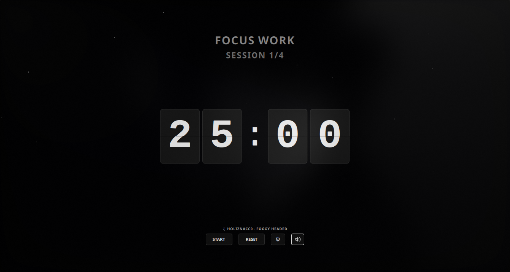
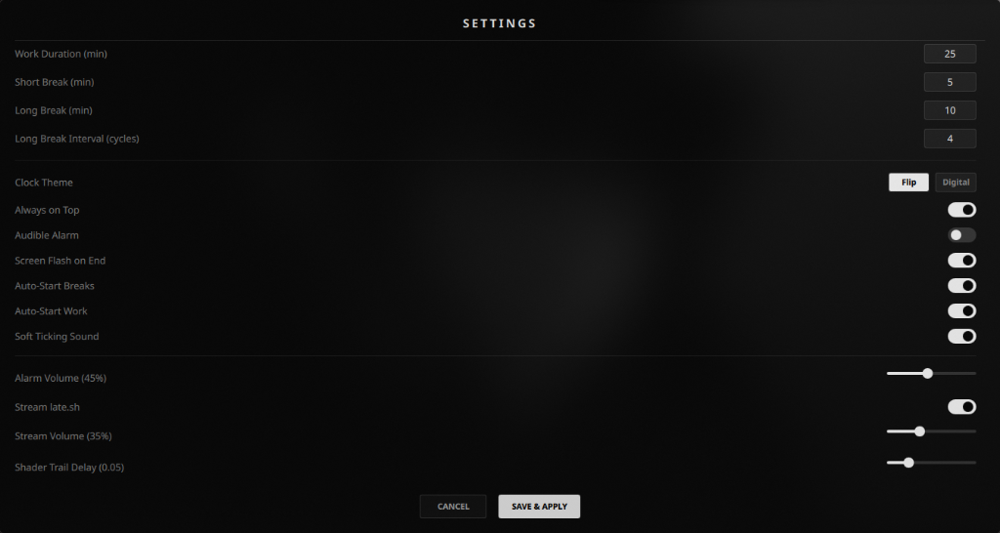

# Tomato Study 🍅
**"Focus. Study. Be Productive."**

Tomato Study is a beautiful, interactive Pomodoro & Flowtime focus timer built with **PySide6** and **Qt Quick (QML)**. It features a stunning 2.5D split-card flip clock animation, procedural OpenGL background shaders, customizable study intervals, global hotkeys, and integration with the [late.sh](https://late.sh) lo-fi study radio stream.

Tested and supported on **Linux** (Ubuntu, Arch, Fedora) and **Windows** (10 & 11).

---

## Previews

### Main Application


### Settings Panel


---

## Key Features

- **Split-Card Flip Clock & Digital Clock**: Sleek and satisfying card flip animations and a clean digital layout.
- **Timer Presets**: Switch between built-in presets like traditional Pomodoro and Flowtime, or create your own custom intervals.
- **Flowtime Mode**: A flexible timer mode that counts up, allowing you to focus as long as you want while automatically calculating appropriate break times.
- **Compact Mode**: Scale down the UI and adjust dimensions for a minimal footprint on your screen.
- **Study Stream Integration**: Stream background study music directly from the `late.sh` vibe radio with a built-in volume slider and mute toggle.
- **Zen Mode**: Double-click the background (or press `Z`) to hide all UI elements and cursor for distraction-free focus.
- **Interactive Background**: High-performance OpenGL fragment shaders rendering drifting stars, shooting meteors, and trail effects that react to your mouse.
- **Customizable Pomodoro Intervals**: Configure work time, short breaks, long breaks, and auto-start preferences.
- **Configurable Hotkeys**: Global shortcuts for playing/pausing, resetting, toggling Zen mode, muting/unmuting, and opening settings.
- **Always on Top**: Pin the timer above other windows while studying, coding, or reading notes.

---

## One-Click Installation & Running

Tomato Study provides production-ready automated installers and launchers for all major desktop platforms:

### Linux & macOS

```bash
# 1. Clone the repository
git clone https://github.com/your-username/tomato-study.git
cd tomato-study

# 2. Run automated installer (verifies Python, configures environment, installs dependencies & creates desktop entry)
./install.sh

# 3. Launch application
./run.sh
```

### Windows

```cmd
# 1. Clone the repository
git clone https://github.com/your-username/tomato-study.git
cd tomato-study

# 2. Double-click install.bat (or run in PowerShell / CMD)
install.bat

# 3. Launch by double-clicking the generated Desktop shortcut or:
run.bat
```

### Standalone / Manual Setup (using Astral `uv`)

If you already have [uv](https://github.com/astral-sh/uv) installed, you can launch directly in one command:

```bash
uv run python src/main.py
```

Or using standard Python virtual environment:
```bash
python3 -m venv .venv
source .venv/bin/activate    # On Windows: .venv\Scripts\activate
pip install -r pyproject.toml
python src/main.py
```

---

## Shortcuts & Controls

| Shortcut | Action | Description |
|---|---|---|
| **Space** | Play / Pause | Start or pause the current focus/break countdown |
| **R** | Reset | Reset current session back to start interval |
| **S** | Settings | Toggle slide-in Settings drawer |
| **Z** | Zen Mode | Toggle minimalist distraction-free view (hides borders & controls) |
| **P** | Study Stream | Toggle background `late.sh` lo-fi music stream |
| **M** | Mute Audio | Instantly mute or restore study music |
| **Double-Click Background** | Zen Mode | Quick mouse trigger for Zen Mode |

*(All hotkeys can be customized inside the **Settings** panel)*

---

## Presentation & Academic Defense Materials

Created for **Introduction to the Major and Soft Skills** (Semester 1, 2026–2027) supervised by **[GVHD]**:

- **[14-Slide Presentation Deck (`docs/presentation/SLIDES.md`)](docs/presentation/SLIDES.md):** Complete 10-minute slide deck script mapped across 5 speakers with slide layouts, notes, and verbatim transition cues.
- **[Speaker Pocket Cue Cards (`docs/presentation/SPEAKER_CUE_CARDS.md`)](docs/presentation/SPEAKER_CUE_CARDS.md):** Printable quick-reference cue cards for Members 1 through 5.
- **[Live Demo Runbook & Q&A Defense Bank (`docs/presentation/DEMO_RUNBOOK_AND_QA.md`)](docs/presentation/DEMO_RUNBOOK_AND_QA.md):** Step-by-step live demo sequence for Slide 8, offline fallback protocol, and supervisor Q&A defense answers.
- **[2m30s Video Recording Guide (`docs/presentation/VIDEO_RECORDING_GUIDE.md`)](docs/presentation/VIDEO_RECORDING_GUIDE.md):** Scene-by-scene recording breakdown, OBS settings, voice-over timings, and caption checklist.

---

## Credits & Technologies

- **UI Framework:** [PySide6](https://wiki.qt.io/Qt_for_Python) & Qt Quick (QML)
- **Shader Pipeline:** OpenGL Fragment Shaders (`ui/shader.frag` & `shader.frag.qsb`)
- **Packaging:** [Astral uv](https://github.com/astral-sh/uv)
- **Study Stream:** Lo-fi background audio stream powered by [late.sh](https://late.sh)

