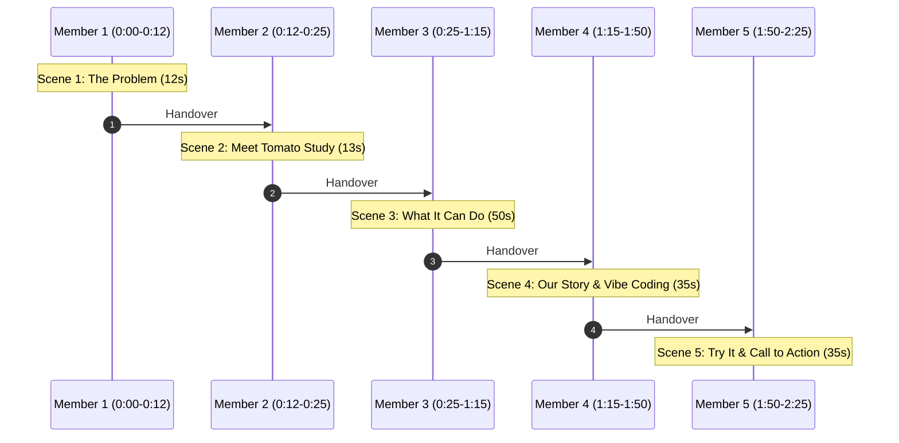

# Tomato Study — Video Production & Recording Guide
**Target Duration:** ~2 Minutes 30 Seconds (150 Seconds Total)  
**Format:** 1080p (1920x1080), 60 FPS, 16:9 Aspect Ratio  
**Voice-over Distribution:** 5 Members (1 Scene per Member)

---

## Technical Recording Specifications (OBS / Screen Recorder)

| Parameter | Recommended Setting | Note |
|---|---|---|
| **Resolution** | 1920 x 1080 (Full HD) | Crisp rendering of QML flip cards & fonts |
| **Framerate** | 60 FPS | Essential for smooth 2.5D flip animation & OpenGL star trails |
| **Audio Format** | 48 kHz / 320 kbps AAC | Clear vocal track + subtle background lo-fi music |
| **Screen Scale** | 100% or 125% Windows/Linux display scale | Avoids blurry Qt font rasterization |
| **Audio Ducking** | Voiceover at -6 dB; `late.sh` background audio at -24 dB | Ensures voices remain distinct and crisp |

---

## Scene-by-Scene Production Script



---

### Scene 1 — The Problem
- **Timestamp:** `0:00 – 0:12` (12 seconds)
- **Speaker:** **Member 1**
- **Visuals On Screen:**
  - Video footage or candid photos of team members at desks surrounded by books and laptops.
  - Student checking phone, looking distracted, sighing.
  - Animated text overlay (bold, elegant typography): **“Losing focus while studying?”**
- **Voice-over Script:**
  > *"Have you ever sat down to study, and a few minutes later your mind is somewhere else? We have. Losing focus while studying is exactly where our project began."*
- **Audio Cue:** Muted ambient room tone transitioning into gentle lo-fi beat.

---

### Scene 2 — Meet Tomato Study
- **Timestamp:** `0:12 – 0:25` (13 seconds)
- **Speaker:** **Member 2**
- **Visuals On Screen:**
  - Quick cinematic reveal of project poster header (*Tomato Study* logo).
  - Smooth pan/zoom onto the live desktop screen running Tomato Study.
  - Camera focuses on the glowing header: `FOCUS WORK · SESSION 1/4 · 25:00` with the 2.5D mechanical flip cards.
- **Voice-over Script:**
  > *"So we created Tomato Study: a beautiful, interactive Pomodoro timer made with PySide6 and Qt Quick. Focus. Study. Be productive."*
- **Text Overlay:** *Made with PySide6 & Qt Quick · Focus. Study. Be Productive.*

---

### Scene 3 — What It Can Do (Core Feature Montage)
- **Timestamp:** `0:25 – 1:15` (50 seconds)
- **Speaker:** **Member 3**
- **Visuals On Screen (Screen recording sequence with 10 feature captions):**
  1. `[0:25]` **Flip Clock:** Split-card animated flip countdown. *(Caption 1: Split-Card Flip Clock)*
  2. `[0:30]` **Digital Clock:** Open settings, click toggle to clean digital mode. *(Caption 2: Digital Clock Layout)*
  3. `[0:35]` **Timer Presets & Intervals:** Selecting Pomodoro preset, adjusting work/break sliders. *(Caption 3: Timer Presets & Custom Intervals)*
  4. `[0:40]` **Flowtime Mode:** Choosing Flowtime, timer starting at 00:00 and counting up. *(Caption 4: Flexible Flowtime Mode)*
  5. `[0:46]` **Compact Mode:** Window scaling down into micro widget. *(Caption 5: Compact Floating Mode)*
  6. `[0:51]` **Always on Top:** Opening a text editor behind it; timer remains pinned. *(Caption 6: Always on Top Pinning)*
  7. `[0:56]` **Study Stream:** Clicking play on the late.sh stream, dragging volume bar, toggling mute. *(Caption 7: late.sh Lo-Fi Study Stream)*
  8. `[1:01]` **Zen Mode:** Pressing `Z` or double-clicking background; all chrome fades away. *(Caption 8: Distraction-Free Zen Mode)*
  9. `[1:06]` **Live Background:** Moving mouse across screen to reveal GPU particle star trails and drifting meteors. *(Caption 9: Interactive OpenGL Fragment Shader)*
  10. `[1:11]` **Hotkeys:** Quick view of the Settings hotkey rebinding drawer. *(Caption 10: Fully Configurable Global Hotkeys)*
- **Voice-over Script:**
  > *"Choose a split-card flip clock or a clean digital display. Pick a preset — Pomodoro, Flowtime, or your own custom intervals — and set your work time, short and long breaks, and auto-start preferences.*
  > 
  > *Flowtime counts up, so you can focus as long as you want while the app works out your breaks. Compact mode shrinks the window, and Always on Top keeps the timer above your other windows.*
  > 
  > *Lo-fi music streams in from late.sh, with its own volume slider and mute button. Need zero distractions? Double-click the background, or press Z, for Zen Mode.*
  > 
  > *The live background draws drifting stars, shooting meteors, and trails that react to your mouse, and every hotkey can be rebound."*

---

### Scene 4 — Our Story & Engineering Workflow
- **Timestamp:** `1:15 – 1:50` (35 seconds)
- **Speaker:** **Member 4**
- **Visuals On Screen:**
  - Browser recording scrolling through the GitHub repository page (commits, README, clean files).
  - B-roll clips or photos of the 5 team members collaborating, writing code, and testing on different laptops.
  - Video clips of classmates trying the app on Windows and Linux and smiling.
  - Text badge card on screen:
    - **“Feedback: 100% Positive Experience”**
    - **“Drawback Noted: Music is currently streaming-only”**
- **Voice-over Script:**
  > *"Our idea came from our own struggle to stay focused. We wanted an app that counts down study time using modern, effective study methods. We designed the code and interface ourselves, in our favorite colors, using vibe coding with AI support: Gemini to check errors, and Claude for general support.*
  > 
  > *We tested it on Windows and Linux and invited our classmates to try it. Their feedback was positive; the only drawback is that the music is a stream, so you can’t choose your own tracks."*

---

### Scene 5 — Try It & Call to Action
- **Timestamp:** `1:50 – 2:25` (35 seconds)
- **Speaker:** **Member 5**
- **Visuals On Screen:**
  - Fast-paced, sleek terminal recording demonstrating the 3-step setup:
    ```bash
    curl -LsSf https://astral.sh/uv/install.sh | sh
    git clone https://github.com/[team-repo]/tomato-study.git
    uv run python src/main.py
    ```
  - Keyboard graphic with highlighted shortcut keys: `Space`, `R`, `S`, `Z`, `P`, `M`.
  - Final end-card with the full project poster, repository URL, and prominent QR code.
- **Voice-over Script:**
  > *"Getting started takes three steps. Install uv, clone our GitHub repository, and run: uv run python src/main.py.*
  > 
  > *Press Space to play or pause, R to reset, and S for settings. Find the code, the website, and installation guides for different systems through the links on screen.*
  > 
  > *Study smarter with Tomato Study!"*
- **Final Visual:** Screen holds on QR Code and GitHub link with the logo: **Tomato Study — “Focus. Study. Be Productive.”**
